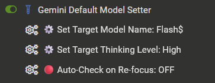
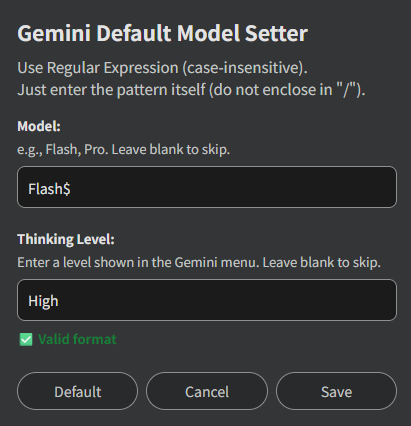

# Gemini Default Model Setter (GDMS)

**For downloads and changelogs, please see the [main README](../../README.md)**

---

## Overview

`Gemini Default Model Setter` is a helper userscript designed to streamline the workflow for Google Gemini power users.  
It automatically selects your preferred model (e.g., "Flash" or "Pro") and thinking level (Low, Medium, or High) when opening a new chat or navigating to an existing conversation.

Stop manually configuring your preferred model and thinking level every time you start a new conversation. Both settings are optional and can be configured independently, while manual changes remain respected during a chat.

---

## Key Features

- **Automatic Selection**: Automatically selects your specified model and thinking level when starting a new chat or opening an existing history thread.
- **Regex Targeting**: Configure both the model name and thinking level using case-insensitive Regular Expressions through a single settings modal.
- **Independent Configuration**: Model and thinking level settings can be configured separately. Leave either field blank to skip automatic selection for that setting.
- **Single-Model Support**: Automatically selects the only available model if necessary, allowing thinking level configuration to work with Gemini Free accounts.
- **Preserves Manual Control**: Sets the initial configuration while allowing you to manually switch models or thinking levels during a chat.
- **Lightweight & Resource-Efficient**: Designed to minimize CPU and memory overhead. Instead of running heavy, continuous background loops, the script utilizes a transient DOM observer that activates only when necessary (such as initial load or SPA navigation) and immediately disconnects once the state is settled.
- **Auto-Check on Re-focus**: An optional fail-safe feature that re-verifies and applies your target configurations when returning to the Gemini tab (useful for background loads or idle sessions).

---

## Screenshots

### 1. Extension Menu Integration
Manage all settings directly from your userscript manager's popup menu.

### 2. Settings Modal
Use Regular Expressions to configure your preferred model and thinking level independently.

**Note:** Works seamlessly with **[AI UX Customizer](../AI-UX-Customizer/README.md)** to enhance the overall visual interface and navigation of your AI chats.

---

## How to Use

- **Initial Setup**: Click your userscript manager extension icon (e.g., Tampermonkey) while on the Gemini page. Select **"⚙️ Set Target Model Name"** or **"⚙️ Set Target Thinking Level"** to open the configuration modal. Enter your preferred model pattern (e.g., `Flash$` or `Pro`) and thinking level pattern (e.g., `High`).
- **Optional Settings**: Leave either input field blank to skip automatic selection for that setting. The two settings operate independently.
- **Gemini Free**: When only one model option is available, the script ensures it is selected regardless of the configured model pattern. Thinking level selection remains available.
- **Past Chat History**: When you open a past conversation from the sidebar, the script applies your configured model and thinking level, allowing you to resume with your preferred settings.

### Understanding "Auto-Check on Re-focus"

By default, this feature is **OFF**.  
When turned **ON**, the script re-checks and applies your configured model and thinking level whenever you return to the Gemini tab.

- **Pros:** Useful for idle tabs or when Gemini loads in the background, helping maintain your preferred configuration.
- **Cons:** If you manually changed the model or thinking level during a conversation and then switched browser tabs, returning to Gemini may reset those selections to your configured targets.
- **Recommendation:** Keep this OFF if you frequently use manual switching alongside heavy tab-switching.

---

## Configuration Examples (Regex)

The script uses case-insensitive Regular Expressions (Regex) to match model names and thinking level labels in the Gemini menu. Enter the pattern itself (do not enclose it in `/ /`).

Patterns must match the labels displayed in your current Gemini interface language.

### Model Name Examples

- **Priority Behavior Note**: If multiple model names match the pattern, the script selects the first matching item. For example, `Flash` may also match `Flash-Lite`, so a more specific pattern is recommended.
- `Flash$` (Default): Matches model names ending with "Flash", while excluding names ending with "Flash-Lite".
- `Pro`: Matches any model name containing "Pro".
- `^Flash-Lite$`: Matches exactly "Flash-Lite".
- **Blank**: Skips automatic model selection.

**Note:** When the menu offers only one model option, the script selects it if necessary, regardless of the configured pattern.

### Thinking Level Examples

- `Low`: Matches the Low thinking level.
- `Medium`: Matches the Medium thinking level.
- `High`: Matches the High thinking level.
- **Blank** (Default): Skips automatic thinking level selection.

Thinking level patterns are matched against the labels shown in the Gemini menu. If your interface uses translated labels, enter a pattern that matches those labels.

Model and thinking level settings are independent. You can configure either one without enabling the other.

---

## Recommended Usage

- **Start Strong, Finish Fast**:  
Configure the script to target `Pro`. When you open a new chat, you are ready for complex reasoning. If you later decide you just need a quick image generated or a simple translation, manually switch to `Flash`. The script will respect your manual choice until you start a new chat.
- **Resume Past Contexts**:  
Even if you started a quick chat in "Flash" yesterday, clicking that history today will automatically upgrade the session to "Pro", allowing you to dive deeper into that previous topic with a more capable model.

---

## Notes & Limitations

- **Site Updates:**
  - This script interacts with the website's UI elements (buttons and menus). If Gemini releases a major UI update or changes the internal class names/structure, the script **may temporarily break** and require an update to function correctly.
- **Browser Support:**
  - The script is primarily developed and tested on **Firefox** with **Tampermonkey**.
  - It is also confirmed to work on Chromium-based browsers, but testing on these platforms is less extensive.
- **Versioning:**
  - This repository only provides the latest version of the script. Past versions are not tracked via GitHub Releases or tags; please refer to the Git commit history if needed.
- **Subscription Compatibility:**
  - This script has been tested with Gemini Free and Pro accounts.
  - Other subscription tiers, including Ultra, have not been tested. Differences in model selectors and thinking mode behavior may affect compatibility. Correct operation is not guaranteed.
- **Upgrading from Earlier Versions:**
  - The previous Extended Thinking ON/OFF setting is not migrated to version 1.6.0.
  - After upgrading, configure your preferred thinking level in the new settings modal. Leaving the field blank disables automatic thinking level selection.

---

## Tested Environment

- This script is designed for **desktop browsers** and does not support mobile environments.
- This script is primarily developed and tested on **Firefox** with **Tampermonkey**.
- It is also confirmed to work on Chromium-based browsers, but testing on these platforms is less extensive.

-----

## License

MIT License

-----

## Author

- [p65536](https://github.com/p65536)
